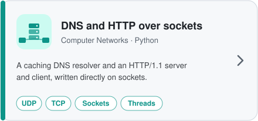
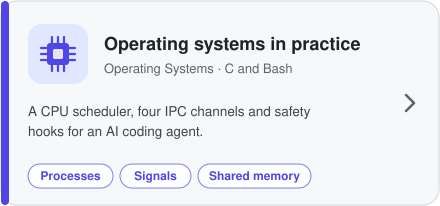

  

 

&nbsp;
&nbsp;
&nbsp;
&nbsp;

 

I'm a computational biology student at Bar-Ilan University. My two main projects are a survival-prediction study on real patient data and a full-stack cloud storage system with web and mobile clients. Alongside them are two smaller projects in networking and operating systems. All of them are documented below.
 

## Projects

<a href="./final-project-lung-cancer-survival">
<picture>
  <source media="(prefers-color-scheme: dark)" srcset="assets/card-final-project-dark.svg">
  
</picture>
</a>

A survival-analysis pipeline built on patient data from the NIH All of Us Research Program, used to test whether representing lung cancer patients as a knowledge graph and modeling them with graph neural networks predicts survival better than a regularized Cox model on the same clinical features.

**[Explore the project →](./final-project-lung-cancer-survival)**

 

<a href="./systems-programming-drive-clone">
<picture>
  <source media="(prefers-color-scheme: dark)" srcset="assets/card-drive-dark.svg">
  
</picture>
</a>

A Google Drive-style storage system: a web client and a mobile app on top of one REST API, backed by MongoDB and a multithreaded C++ storage server. Users can register, organize files and folders, share them with hierarchical permissions and search them. Built in stages, starting from the C++ server and ending with the two clients.

**[Explore the project →](./systems-programming-drive-clone)**

 

## Further projects

Tools built close to the operating system and the network, each with its own test suite and documented design decisions.

<a href="https://github.com/OrBrener1/protocols-in-practice"><picture><source media="(prefers-color-scheme: dark)" srcset="assets/card-networks-dark.svg"></picture></a>&nbsp;<a href="https://github.com/OrBrener1/os-in-practice"><picture><source media="(prefers-color-scheme: dark)" srcset="assets/card-os-dark.svg"></picture></a>

&emsp;&emsp;&emsp;&emsp;&emsp;&emsp;&emsp;&emsp;&emsp;**[Explore the project →](https://github.com/OrBrener1/protocols-in-practice)** &emsp;&emsp;&emsp;&emsp;&emsp;&emsp;&emsp;&emsp;&emsp;&emsp;&emsp;&emsp;&emsp;&emsp;&emsp;&emsp;&emsp;&emsp;&emsp;&emsp;&emsp;&emsp;&emsp; **[Explore the project →](https://github.com/OrBrener1/os-in-practice)**
## Technical toolkit

| | |
|---|---|
| **Languages** | Python, SQL, C, C++, Java, JavaScript, Bash, HTML/CSS |
| **Data & ML** | pandas, PyTorch / PyTorch Geometric, matplotlib / seaborn, exploratory data analysis, feature engineering |
| **Statistics** | Survival analysis, censored data, cross-validation, model evaluation and benchmarking |
| **Software engineering** | Object-oriented programming, client–server architecture, REST APIs, concurrency, networking |
| **Web & data stores** | Node.js, React, React Native, MongoDB, BigQuery |
| **Tools & process** | Docker, Git, Scrum |

 

## Education

**B.Sc. Computational Biology**, Bar-Ilan University · 2023–present

Computational biology combines computer science with biology, chemistry and biotechnology.

My work applies the computational side to clinical and biological data.

**Core coursework** 

    · Algorithms · Communication Networks · Operating Systems · Machine Learning · Bioinformatics · Computational Genomics · Biochemistry · Human–Machine Interface

 

## Contact

